<p align="center">
  
</p>

<p align="center">
  <a href="https://github.com/ishandutta2007/Awesome-Awesome-Awesome"></a>
  <a href="https://discord.gg/jc4xtF58Ve"></a>
  <a href="https://github.com/ishandutta2007/Awesome-NLP-Frameworks/stargazers"></a>
  <a href="https://github.com/ishandutta2007/Awesome-NLP-Frameworks/network/members"></a>
  <a href="https://github.com/ishandutta2007/Awesome-NLP-Frameworks/issues"></a>
  <a href="https://github.com/ishandutta2007/Awesome-NLP-Frameworks/blob/main/LICENSE"></a>
  <a href="https://github.com/ishandutta2007"></a>
</p>

# 🧠 Awesome NLP Frameworks — Production-Grade Natural Language Processing Ecosystem

> **A curated catalog of premier open-source NLP libraries, state-of-the-art transformer toolkits, multilingual text pipelines, and enterprise SaaS language APIs.**

Welcome to **Awesome-NLP-Frameworks**! This repository provides an authoritative, benchmark-informed directory of tools for natural language processing (NLP), text mining, tokenization, named entity recognition (NER), part-of-speech (POS) tagging, sentiment classification, semantic embeddings, and language modeling. Whether you are building real-time CPU-optimized pipelines, orchestrating Spark-scale batch analysis, or deploying LLM inference APIs, this guide indexes the entire landscape.

---

## 📑 Table of Contents

- [🌐 Sector Overview & Market Dynamics](#-sector-overview--market-dynamics)
- [🏢 Enterprise SaaS & Managed NLP Platforms](#-enterprise-saas--managed-nlp-platforms)
- [⚡ Open-Source GitHub Frameworks](#-open-source-github-frameworks)
- [🎯 Framework Selection Matrix](#-framework-selection-matrix)
- [🤝 How to Contribute](#-how-to-contribute)
- [📈 Star History](#-star-history)
- [💖 Support & Community](#-support--community)
- [⚖️ Disclaimer & License](#-disclaimer--license)

---

## 🌐 Sector Overview & Market Dynamics

The global **Natural Language Processing (NLP) market size was valued at approximately $24.1 Billion in 2023** and is projected to surpass **$112.3 Billion by 2030**, expanding at a compound annual growth rate (**CAGR of ~27.6%**), driven by rapid enterprise adoption of transformer architectures, generative AI interfaces, multilingual semantic search, and automated compliance pipelines.

The NLP industry is **moderately fragmented and structurally bifurcated rather than a single winner-take-all monopoly**. Hyperscale cloud conglomerates (Microsoft, Alphabet/Google, Amazon AWS) dominate enterprise infrastructure contracts with unified compliance, zero-egress SLAs, and healthcare/finance certifications, while nimble AI-first challengers (such as Cohere and Hugging Face) lead in retrieval-augmented generation (RAG) and model hub ecosystems. Concurrently, high-efficiency open-source frameworks (spaCy, Transformers, NLTK, fastText) maintain enduring market power by empowering organizations to retain data sovereignty, eliminate recurring per-token API taxes, and achieve sub-millisecond CPU inference.

---

## 🏢 Enterprise SaaS & Managed NLP Platforms

The following table indexes leading managed NLP cloud services and proprietary APIs, sorted in descending order by **Company Size / Valuation**.

| 🏷️ Platform | 🏢 Company / Backer | 💰 Company Size / Valuation | ⚡ Key Capabilities & Differentiator | 💳 Starting Tier Pricing | 🎁 Free Tier Limits |
| :--- | :--- | :--- | :--- | :--- | :--- |
| **[Azure AI Language](https://azure.microsoft.com/en-us/products/ai-services/ai-language)** | Microsoft | **~$3.12 Trillion** Market Cap (~$245B Ann. Rev.) | Enterprise PHI/PII redaction, conversational language understanding (CLU), sentiment analysis, and Text Analytics for Health. | **$1.00 per 1,000 text records** (Standard S tier; 1 record = up to 1,000 characters for Sentiment/NER up to 500K units/month). | **Free F0 tier**: **5,000 text records per month free forever** across features; plus **$200 Azure cloud credits for 30 days** upon signup. |
| **[Google Cloud Natural Language API](https://cloud.google.com/natural-language)** | Alphabet / Google | **~$2.15 Trillion** Market Cap (~$307B Ann. Rev.) | Native entity salience scoring (ranks topic importance within text), deep syntactic analysis, and Vertex AI multimodal workflow integration. | **$1.00 per 1,000 text units** (for Sentiment & Entity Analysis from 5,001 to 1M units/month; 1 unit = 1,000 unicode characters). | **5,000 text units per feature per month free forever** (Entity, Sentiment, Syntax); plus **$300 cloud credits valid for 90 days**. |
| **[Amazon Comprehend](https://aws.amazon.com/comprehend/)** | Amazon (AWS) | **~$1.98 Trillion** Market Cap (~$574B Ann. Rev.) | Tight AWS CloudWatch/S3 integration, synchronous streaming & asynchronous high-throughput batching, custom classification, and PII masking. | **$0.0001 per unit** (1 unit = 100 characters; equivalent to $1.00 per 10,000 characters) for requests up to 10M units/month. | **AWS Free Tier**: **50,000 text units (5,000,000 characters) per month for the first 12 months** across Sentiment, Entities, and Key Phrases. |
| **[IBM Watson Natural Language Understanding](https://www.ibm.com/products/natural-language-understanding)** | IBM | **~$210 Billion** Market Cap (~$62B Ann. Rev.) | Custom enterprise domain annotators (Watson Knowledge Studio), deep entity-relation extraction, emotion profiling, and hybrid-cloud support. | **$0.003 per NLU item** on Standard Plan up to 250,000 items/month (1 item = 1 feature enrichment per 10,000 characters). | **Lite Plan free forever**: **30,000 NLU items per month** with 1 custom domain model and 1 concurrent request slot. |
| **[Cohere Platform](https://cohere.com/)** | Cohere | **~$5.5 Billion** Valuation (~$35M+ ARR) | Specialized enterprise RAG architectures, Command R/R+ models with verifiable citations, multilingual 1024-dim Embed v3, and state-of-the-art Rerank. | **$0.10 per 1M tokens** for Embed v3; **$1.00 per 1,000 search queries** for Rerank v3; **$0.15 per 1M input tokens** for Command R. | **Free Trial Key free forever**: **1,000 API calls per month** for non-production evaluation across Embed, Generate, and Rerank endpoints. |
| **[Hugging Face Inference Platform](https://huggingface.co/inference-api)** | Hugging Face | **~$4.5 Billion** Valuation ($235M Series D) | Instant serverless deployment of 100,000+ open-source transformer models, dedicated auto-scaling Inference Endpoints on AWS/Azure/GCP. | **$9.00 / month** (Pro Tier); Dedicated Endpoints start at **$0.06 / hour** (CPU) and **$0.50 / hour** (Nvidia T4 GPU instances). | **Serverless Inference API free forever**: Up to **30,000 input tokens per month** across community checkpoints with rate-limited queues. |

---

## ⚡ Open-Source GitHub Frameworks

The following open-source frameworks and libraries represent the foundational building blocks of modern NLP engineering. Repositories are listed in descending order by **GitHub Star Count**, with live stargazer metrics.

1. **[Hugging Face Transformers](https://github.com/huggingface/transformers)** [](https://github.com/huggingface/transformers/stargazers)  
   - 📜 **License**: Apache 2.0  
   - 🎯 **Focus**: The definitive ecosystem for state-of-the-art transformer architectures (BERT, RoBERTa, DeBERTa, T5, LLaMA, Mistral).  
   - 💡 **Key Strengths**: Unified API interoperable across PyTorch, TensorFlow, and JAX. Reaches ~93–94 F1 on CoNLL-2003 NER with fine-tuned checkpoints. Provides direct integration with Hugging Face Hub for instant checkpoint downloads and model sharing.  
   - 🏆 **Best For**: Cutting-edge research, custom LLM fine-tuning, and high-accuracy supervised sequence modeling where GPU acceleration is standard.

2. **[spaCy](https://github.com/explosion/spaCy)** [](https://github.com/explosion/spaCy/stargazers)  
   - 📜 **License**: MIT  
   - 🎯 **Focus**: Industrial-strength, high-speed NLP in Python and Cython.  
   - 💡 **Key Strengths**: Processes up to **50,000 tokens per second** on CPU. Structured single `Doc` container preserves tokens, POS tags, syntactic dependencies, and named entities in memory. Features `nlp.pipe()` for batched document streams and native support for 75+ natural languages.  
   - 🏆 **Best For**: High-throughput production web applications, ETL pipelines, and CPU-constrained microservices prioritizing latency over raw GPU F1 gains.

3. **[fastText](https://github.com/facebookresearch/fastText)** [](https://github.com/facebookresearch/fastText/stargazers)  
   - 📜 **License**: MIT  
   - 🎯 **Focus**: Ultra-fast text classification and subword-level word representation learning from Meta AI Research.  
   - 💡 **Key Strengths**: Trains classifiers on millions of text documents in seconds using bag-of-words and n-gram tricks. Character n-gram embeddings elegantly solve out-of-vocabulary (OOV) tokens and morphologically rich languages.  
   - 🏆 **Best For**: Low-latency edge inference, language identification, intent routing, and massive-scale sentiment filtering.

4. **[Sentence Transformers](https://github.com/UKPLab/sentence-transformers)** [](https://github.com/UKPLab/sentence-transformers/stargazers)  
   - 📜 **License**: Apache 2.0  
   - 🎯 **Focus**: State-of-the-art dense semantic sentence, paragraph, and image embeddings for vector search.  
   - 💡 **Key Strengths**: Computes dense vector representations that can be compared using cosine similarity; speeds up semantic search over brute-force BERT cross-encoders by a factor of 10,000x. Direct integration with vector databases like Chroma, FAISS, Milvus, and Qdrant.  
   - 🏆 **Best For**: Retrieval-Augmented Generation (RAG), semantic document deduplication, clustering, and neural search engines.

5. **[Gensim](https://github.com/piskvorky/gensim)** [](https://github.com/piskvorky/gensim/stargazers)  
   - 📜 **License**: LGPL-2.1  
   - 🎯 **Focus**: Topic modeling, document indexing, and unsupervised semantic similarity for large text corpora.  
   - 💡 **Key Strengths**: Memory-independent algorithms (Word2Vec, FastText, Latent Dirichlet Allocation / LDA, LSI) that stream text files directly from disk without fitting the whole corpus into RAM.  
   - 🏆 **Best For**: Unsupervised topic discovery, corpus clustering, document similarity indexing, and classical vector spaces.

6. **[NLTK](https://github.com/nltk/nltk)** [](https://github.com/nltk/nltk/stargazers)  
   - 📜 **License**: Apache 2.0  
   - 🎯 **Focus**: Foundational natural language toolkit for education, prototyping, and linguistic research.  
   - 💡 **Key Strengths**: Exhaustive library of statistical algorithms, stemmers (Porter, Snowball), tokenizers (WordPunct, Treebank), chunkers, and 50+ linguistic corpora/lexicons (WordNet, Brown Corpus).  
   - 🏆 **Best For**: Academic computer science curricula, linguistic research, prototyping, and deterministic lexical parsing.

7. **[Flair](https://github.com/flairNLP/flair)** [](https://github.com/flairNLP/flair/stargazers)  
   - 📜 **License**: MIT  
   - 🎯 **Focus**: SOTA contextual string embeddings and sequential token labeling framework developed by Humboldt University.  
   - 💡 **Key Strengths**: Produces benchmark-leading NER scores (~94 F1 on CoNLL) by combining character-level language models with subword representations. Clean, highly Pythonic object-oriented API for zero-shot and few-shot NER.  
   - 🏆 **Best For**: Mission-critical named entity recognition, biomedical information extraction, and experimental sequence tagging.

8. **[AllenNLP](https://github.com/allenai/allennlp)** [](https://github.com/allenai/allennlp/stargazers)  
   - 📜 **License**: Apache 2.0  
   - 🎯 **Focus**: Open-source PyTorch-based research library for designing and evaluating deep learning NLP models.  
   - 💡 **Key Strengths**: Clean abstractions for dataset readers, vocabularies, token indexers, and evaluation metrics. Deeply integrated with Allen Institute for AI (AI2) benchmarks.  
   - 🏆 **Best For**: Academic research experimentation, question-answering system design, and custom PyTorch model prototyping.

9. **[Stanford CoreNLP](https://github.com/stanfordnlp/CoreNLP)** [](https://github.com/stanfordnlp/CoreNLP/stargazers)  
   - 📜 **License**: GNU GPL v3+  
   - 🎯 **Focus**: Battle-tested, production-ready Java natural language analysis suite with native web server capabilities.  
   - 💡 **Key Strengths**: Robust rule-based and statistical pipelines for dependency parsing, co-reference resolution, named entity recognition, and sentiment treebanks. Provides a built-in HTTP server for multi-language microservice integration.  
   - 🏆 **Best For**: Java and JVM-centric enterprise architectures, formal grammatical analysis, and deterministic dependency parsing.

10. **[TextBlob](https://github.com/sloria/TextBlob)** [](https://github.com/sloria/TextBlob/stargazers)  
    - 📜 **License**: MIT  
    - 🎯 **Focus**: Simplified, beginner-friendly Python text processing and sentiment analysis.  
    - 💡 **Key Strengths**: Provides an intuitive, clean interface over NLTK and Pattern. Quick one-line syntax for noun phrase extraction, part-of-speech tagging, spelling correction, and polarity/subjectivity scoring.  
    - 🏆 **Best For**: Rapid prototyping, student projects, hackathons, and lightweight sentiment analysis scripts.

11. **[Pattern](https://github.com/clips/pattern)** [](https://github.com/clips/pattern/stargazers)  
    - 📜 **License**: BSD-3-Clause  
    - 🎯 **Focus**: Web mining, sentiment analysis, machine learning, and linguistic toolkit from CLiPS.  
    - 💡 **Key Strengths**: Bundles web scrapers, crawler modules, HTML parsers, WordNet integration, and n-gram search with natural language parsers for English, Spanish, German, French, and Italian.  
    - 🏆 **Best For**: End-to-end web information harvesting, social data extraction, and classical linguistic analysis.

12. **[Stanza](https://github.com/stanfordnlp/stanza)** [](https://github.com/stanfordnlp/stanza/stargazers)  
    - 📜 **License**: Apache 2.0  
    - 🎯 **Focus**: Stanford NLP Group's official Python toolkit for accurate multilingual linguistic analysis.  
    - 💡 **Key Strengths**: Out-of-the-box neural pipelines supporting **70+ natural languages** with Universal Dependencies treebank standards. Exceptional grammatical parsing precision and native client access to Stanford CoreNLP Java servers.  
    - 🏆 **Best For**: Cross-lingual comparative linguistics, grammatical tree analysis, and research on under-resourced languages.

13. **[John Snow Labs Spark NLP](https://github.com/JohnSnowLabs/spark-nlp)** [](https://github.com/JohnSnowLabs/spark-nlp/stargazers)  
    - 📜 **License**: Apache 2.0 (Core)  
    - 🎯 **Focus**: Scalable distributed NLP built directly natively on Apache Spark for big data pipelines.  
    - 💡 **Key Strengths**: Features over **15,000+ free pretrained pipelines and models in 250+ languages**. Operates directly on Spark DataFrames with zero serialization penalties between distributed executors. Specialized domain extensions available for Healthcare, Legal, and Finance.  
    - 🏆 **Best For**: Big data processing pipelines, petabyte-scale data lakes, Spark clusters, and regulated enterprise environments.

14. **[GLiNER](https://github.com/urchade/GLiNER)** [](https://github.com/urchade/GLiNER/stargazers)  
    - 📜 **License**: Apache 2.0  
    - 🎯 **Focus**: Generalist, lightweight bidirectional transformer for zero-shot Named Entity Recognition.  
    - 💡 **Key Strengths**: Extracts arbitrary entity types on the fly at inference time without requiring any domain-specific labeled training data. Achieves ~48 F1 on zero-shot out-of-domain benchmarks, outperforming large LLMs (GPT-3.5/4) at less than 1% of the model parameter footprint.  
    - 🏆 **Best For**: Dynamic NER schemas, schema-free information extraction, edge deployments, and synthetic data tagging.

15. **[FARM](https://github.com/deepset-ai/FARM)** [](https://github.com/deepset-ai/FARM/stargazers)  
    - 📜 **License**: Apache 2.0  
    - 🎯 **Focus**: Fast and resilient transfer learning framework for NLP, crafted by deepset (the creators of Haystack).  
    - 💡 **Key Strengths**: Modular multi-task learning architecture with adaptive model heads for question answering, text classification, and token classification. Seamlessly serves as the model-training engine underpinning enterprise Haystack RAG pipelines.  
    - 🏆 **Best For**: Domain-specific fine-tuning, QA model preparation, and enterprise retrieval-augmented generation backbones.

---

## 🎯 Framework Selection Matrix

| 🛠️ Framework | ⚡ Inference Speed | 🎯 Accuracy Ceiling | 💻 Compute Requirement | 🌐 Multilingual Support | 💼 Optimal Production Use Case |
| :--- | :--- | :--- | :--- | :--- | :--- |
| **spaCy** | ⚡⚡⚡⚡⚡ (50k tok/s) | High (~90 F1) | CPU / Single core | 75+ Languages | Low-latency web backends, high-speed parsing, and entity extraction. |
| **Hugging Face** | ⚡⚡ (Batch dependent) | Peak SOTA (~94 F1) | GPU recommended | 100+ Languages | Advanced language modeling, custom LLM fine-tuning, complex NLP tasks. |
| **fastText** | ⚡⚡⚡⚡⚡ (100k+ tok/s) | Moderate (~85 F1) | Minimal CPU / Mobile | 150+ Languages | Ultra-fast language identification, intent routing, massive classification. |
| **Sentence-Transformers** | ⚡⚡⚡⚡ (Dense vector) | Very High (Bi-encoder) | CPU or GPU | 50+ Languages | Semantic search, RAG vector indexing, embedding generation. |
| **Stanza** | ⚡⚡ (Neural pipeline) | Very High (~92 F1) | CPU or GPU | 70+ Languages | Cross-lingual linguistic research, Universal Dependencies parsing. |
| **Spark NLP** | ⚡⚡⚡⚡ (Cluster distributed) | High (~90 F1) | Spark Cluster / RAM | 250+ Languages | Petabyte-scale enterprise batch data lakes, Spark ML pipelines. |
| **GLiNER** | ⚡⚡⚡⚡ (Lightweight) | SOTA Zero-shot (~48 F1) | CPU friendly | Multilingual models | Zero-shot NER with dynamic labels without training datasets. |
| **NLTK** | ⚡⚡⚡ (Process-level) | Rule-based / Baseline | Lightweight CPU | English primarily | Linguistic education, deterministic tokenizing, baseline scripts. |

---

## 🤝 How to Contribute

Contributions are warmly welcomed! Help keep this ecosystem comprehensive, factual, and up to date:

1. **Fork this repository** to your personal GitHub account.
2. **Create a descriptive feature branch**:
   ```bash
   git checkout -b feat/add-new-nlp-framework
   ```
3. **Add or update entries** in `README.md`:
   - Follow the established formatting conventions (License, Focus, Strengths, Best For).
   - Ensure open-source entries include the live `shields.io` star badge linking to `/stargazers`.
   - Maintain descending order by star count or SaaS company valuation.
4. **Submit a Pull Request** with a concise summary of the framework and benchmark evidence.

For an extensive directory of awesome developer collections, explore [Awesome-Awesome-Awesome](https://github.com/ishandutta2007/Awesome-Awesome-Awesome).

---

## 📈 Star History

[](https://star-history.dera.page/#ishandutta2007/Awesome-NLP-Frameworks&type=date&legend=top-left)

---

## 💖 Support & Community

Thank you for exploring **Awesome-NLP-Frameworks**! If this curated collection helps your NLP research, engineering pipeline, or production applications, please consider supporting the project:

- ⭐ **Star this repository** to help other engineers discover premier NLP tools.
- 🍴 **Fork and contribute** new libraries, frameworks, benchmarks, or documentation improvements.
- 📢 **Share this repository** on social media, LinkedIn, tech blogs, and developer Discord servers.
- ☕ **Buy a Coffee & Sponsor**: Support ongoing maintenance and continuous curation via the [GitHub Sponsor Dashboard](https://github.com/sponsors/ishandutta2007).

---

## ⚖️ Disclaimer & License

- This catalog is a **community-curated index** provided for educational and architectural evaluation purposes. Product names, logos, and brands are property of their respective owners.
- Performance throughput figures and benchmark F1 metrics are referenced from official project documentation, CoNLL evaluation benchmarks, and empirical engineering tests.
- Distributed under the [MIT License](LICENSE). Contributions adhere to standard open-source conventions.
